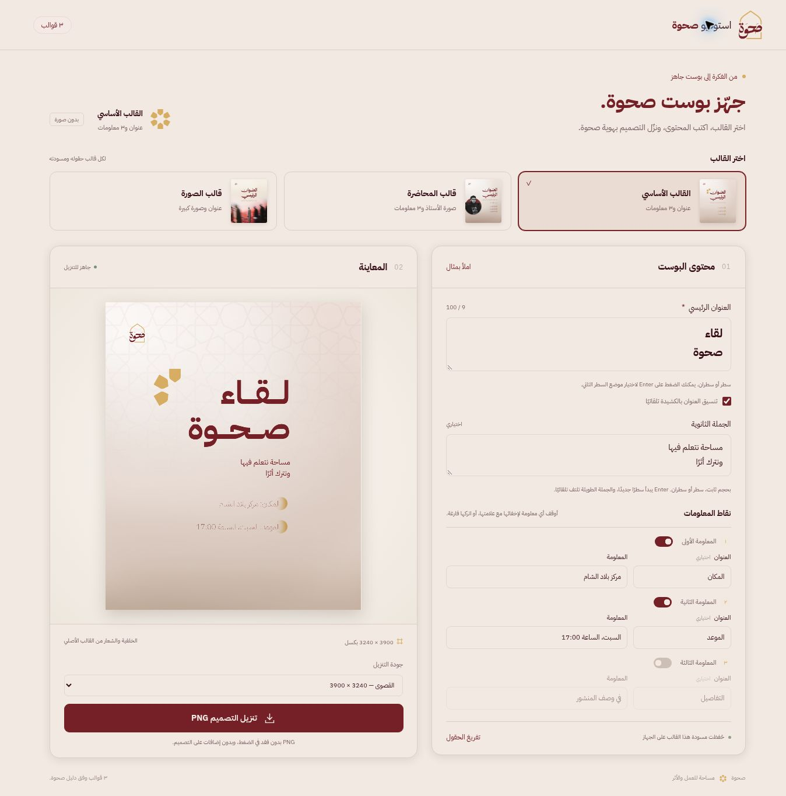

# استوديو صحوة — قوالب البوستات

**رابط الاستخدام:** https://sahwa-post.vercel.app/

الرابط متاح للفريق مباشرة. تنزيل PNG لا يحتاج تثبيت برامج.

أداة عربية بسيطة لتعبئة ثلاثة قوالب بهوية صحوة. اختر القالب فتظهر حقوله، مع معاينة مباشرة وتنزيل الصورة الجاهزة.

| القالب | الحقول |
| --- | --- |
| الأساسي | عنوان، جملة ثانوية، ٣ معلومات بعناوين اختيارية |
| المحاضرة | عنوان، جملة ثانوية، اسم الأستاذ، ٣ معلومات وصورة الأستاذ |
| الصورة | عنوان، جملة ثانوية وصورة كبيرة مع التدرج الأصلي |

## الاستخدام

افتح رابط الموقع المنشور في متصفح حديث. اختر القالب، اكتب المحتوى، راجع المعاينة، ونزّل PNG. جودة التنزيل الافتراضية 3240 × 3900 (٣ أضعاف مقاس القالب)، مع خيار 2160 × 2600 أو المقاس الأصلي 1080 × 1300. النص يُرسم من جديد بالدقة المطلوبة، وكذلك الصورة المرفوعة؛ تكبير خلفية أو صورة صغيرة لا يخلق تفاصيل غير موجودة في المصدر. PNG يحفظ الناتج دون ضغط يفقد التفاصيل.

العنوان يقبل سطرًا أو سطرين ويضبط حجمه داخل المساحة. خيار الكشيدة يوزع تمديدات محدودة عند مواضع اتصال صحيحة، دون تغيير الحروف أو التشكيل أو مدّ الخط أفقيًا. يمكن إيقافه أو كتابة كشيدة يدويًا؛ لا تضيف الأداة كشيدة جديدة فوق كشيدة المستخدم. الجملة الثانوية تحتفظ بحجم القالب الطبيعي وتلتف إلى سطرين كحد أقصى، وتدعم Enter. النص الزائد يوقف التصدير بدل تصغير الجملة.

لكل معلومة مفتاح لإظهارها أو إخفائها مع علامتها. إيقاف المعلومة يحافظ على مسودتها، ويستثنيها من الرسم والتحقق. يمكن إيقاف المعلومات الثلاث كلها، كما يمكن إخفاء المعلومة بترك قيمتها فارغة.

في قالب المحاضرة، الصورة العادية JPG أو WebP أو PNG تبقى داخل الدائرة، مع لون الصورة الأصلي وخيار الأبيض والأسود. صورة PNG المفرغة تستخدم إطار الشخص الأصلي تلقائيًا؛ تُزال الهوامش الشفافة كي يظهر الشخص بحجم مناسب. يمكن استخدام صورة عامة داخل الدائرة عند عدم نشر صورة الأستاذ أو الأستاذة. قالب الصورة يحتفظ بالتدرج الأصلي فوق أي صورة بديلة. أدوات الحجم والتحريك تضبط الصورة؛ زر «الصورة الأصلية» يعيد صورة القالب. لكل قالب مسودة وصورة وإعدادات محفوظة على الجهاز، وتنتقل مسودة الإصدار الأول تلقائيًا للقالب الأساسي.

زر «تفريغ صورة الشخص تلقائيًا» خيار مستقل لقالب المحاضرة. يستخدم [MediaPipe Selfie Segmenter](https://ai.google.dev/edge/mediapipe/solutions/vision/image_segmenter/web_js) في المتصفح؛ صور المستخدم لا تُرفع إلى خادم معالجة. يحتاج تحميل المكتبة والنموذج إلى الإنترنت، ولا يُضمن تفريغ دون إنترنت. المخصص هو صورة شخص واضحة، وليس إزالة خلفية منظر عام. يحتفظ زر «إلغاء التفريغ» بملف المستخدم الأصلي. قد تفقد الحواف الدقيقة أو الشعر بعض التفاصيل؛ قارن النتيجة أو استخدم PNG مفرغًا يدويًا عند الحاجة إلى حواف دقيقة. الصورة المعالجة تُجهّز حتى 2560 بكسل في أطول ضلع، وهو أكثر من مساحة إطار الشخص في التصدير الأقصى.

## دليل صحوة والخطوط

الإصدار 1.3.1 يطبق دليل صحوة المرفق: العنابي `#752026` والعنابي الداكن `#350e15` والذهبي `#d6ad63` والأوف وايت `#f2e9e2`. يحافظ على الشعار في أعلى يسار البوست وإضاءة الخلفيات الأصلية وتوازن مساحات النص والصورة. الأيقونة الأصلية مستخرجة من الدليل؛ القالب الأساسي يحتفظ بأيقونته الموجودة، وقالب المحاضرة يضعها عند زاوية الصورة، وقالب الصورة يضعها بخفة في الخلفية. واجهة الأداة تستخدم الشعار والأيقونة الأصليين أيضًا.

- الخلفيات، الشعار، الزخارف، أقنعة الصور والعلامات الذهبية مستخرجة من ملفات Illustrator وPhotoshop الأصلية، دون إعادة رسمها.
- الجملة الثانوية واسم الأستاذ تستخدم IBM Plex Sans Arabic Regular (400)، والمعلومات تستخدم Thin (100)، وفق الدليل. الخطوط الكاملة مضمنة داخل الموقع، مع ترخيص OFL. النصوص الافتراضية والمعدلة تستخدم الأوزان نفسها؛ لا يُستبدل النص الافتراضي بصورة قديمة بوزن مختلف.
- خط العناوين الجديدة مثبت داخل الموقع: IBM Plex Sans Arabic Bold. يُحمّل تلقائيًا للقوالب الثلاثة وعلى أي جهاز. لا يوجد صندوق إعدادات للخط أو رفع أو انتظار أو وضع مؤقت، ولا تضاف علامة تجربة إلى المعاينة أو اسم ملف التنزيل.
- العنوان الافتراضي «العنوان الرئيسي» يحتفظ بمسارات Illustrator وصور Photoshop الأصلية؛ العناوين الجديدة تُرسم بالخط المثبت داخل مساحتها مع الضبط التلقائي والكشيدة.
- اسم الخط وملفه معرفان في `dist/assets/heading-font.json`. عند توفير ملف عنوان آخر، يضيفه المطور إلى `dist/assets/` ويحدث هذا الملف ويعيد التجميع والنشر مرة واحدة؛ ينتقل الخط نفسه إلى الفريق دون رفع محلي لكل شخص. ملف الخط يجب أن يكون TTF أو OTF كاملًا ومسموحًا بتوزيعه ضمن الموقع.
- دليل الهوية يذكر Asal Arabic وMilan Display. ملفهما الكامل غير موجود في المرفقات؛ الخط المضمن فعليًا حاليًا هو IBM Bold. IBM مضمن مع ترخيص OFL، ولا يُعاد تسميته داخل برنامج الخط باعتباره تصميمًا أصليًا لصحوة.
- محرك النص في المتصفح قد يختلف عن Illustrator في البدائل الأسلوبية والتنعيم. عند تزويد الخط الأصلي، تُراجع عينة للعناوين قبل اعتماد تطابق إخراج جديد.
- الحقول والصور تُحفظ محليًا في المتصفح؛ لا تُرسل إلى خادم معالجة. فشل الحفظ المحلي لا يمنع استخدام الأداة في الجلسة الحالية.
- الكشيدة تستخدم بيانات اتصال الحروف من Unicode 17.0.0؛ إشعار الترخيص داخل `dist/assets/Unicode-LICENSE.txt`. مكتبة MediaPipe المثبتة على الإصدار 0.10.32 والنموذج مثبت على float16/1، وتُحمّل عند الطلب. النموذج ذو قناة ثقة واحدة للشخص، وليس قناة ثانية للخلفية.

## الاستضافة على Vercel

المشروع `sahwa-post` على الحساب المتصل، والرابط الأساسي هو رابط Vercel أعلاه. يحدد `vercel.json` الإعداد Other ومجلد الإخراج `dist`؛ يُنشر المجلد المجهز دون تثبيت اعتماديات أو تشغيل Python على Vercel. `.vercelignore` يستثني ملفات التطوير والمراجع والصور التوثيقية من الرفع.

عند تغيير القوالب أو الخطوط، شغّل `npm run build` محليًا وأضف ناتج `dist` إلى نفس commit قبل رفعه. الحقول والصور المحفوظة في المتصفح تتبع نطاق الموقع: ما حُفظ على رابط ChatGPT السابق يبقى على ذلك الرابط، ولا ينتقل تلقائيًا إلى Vercel. هذه الأداة لا تحتوي قاعدة بيانات مركزية لمسودات الفريق.



## الملفات

- `design/template.ai`: نسخة مرجعية من الملف المرفق.
- `dist/engine.js`: تعريف القالب والتحقق من ملاءمة النص ومحرك الرسم.
- `dist/app.js`: اختيار القالب، الحقول، حفظ المسودات والصور، تحميل الخط المضمن والتصدير.
- `dist/arabic-joining.js`: بيانات اتصال الحروف للكشيدة.
- `dist/portrait.js`: الهوامش الشفافة، تحميل أداة تفريغ الشخص وتركيب PNG المفرغ.
- `dist/assets/psb2/` و`dist/assets/psb3/`: العناصر المستخرجة وتعريف الحقول والأبعاد وبيانات مصدر القالب.
- `dist/index.html`: واجهة الاستخدام.
- `scripts/prepare-assets.py`: استخراج عناصر القالب وتجهيز الخطوط المفتوحة.
- `scripts/prepare-psb-assets.py`: استخراج طبقات القالبين الآخرين من المرفقات الأصلية.
- `scripts/prepare-brand-guide.py`: استخراج شعار وأيقونة دليل صحوة وتجهيز IBM Regular وThin.
- `dist/assets/heading-font.json`: إعداد خط العناوين المشترك والمدمج في الموقع.
- `dist/assets/brand-guide.json`: ألوان الهوية وأوزان الخطوط وقواعد التكوين المطبقة.
- `scripts/build-templates.py`: تجميع القوالب والصور والخطوط المجهزة داخل الموقع.
- `tests/verify.cjs`: اختبارات لمحرك الرسم والتصدير، دون تشغيل متصفح.

## التحقق وإعادة التجميع

```bash
node --check dist/engine.js
node --check dist/app.js
npm install
npm test
npm run build
```

تعتمد الاختبارات على `@napi-rs/canvas` ويثبّته `npm install`. تشمل ٦٤ فحصًا للرسم والخطوط والكشيدة، التصدير المباشر بالخط المضمن في القوالب الثلاثة، قبول أسماء خطي العناوين في محرك الرسم ورفض برامج الخطوط الناقصة، ألوان الهوية وأصولها، تطبيق Regular وThin على النصوص الافتراضية والمعدلة، ثبات حجم الجملة الثانوية، إظهار المعلومات وإخفائها، استبدال الصور وإطارها، التصدير ٣×، الهوامش الشفافة وتحويل الثقة إلى قناع شفافية. الاختبارات الآلية تعمل على Canvas خارج المتصفح. تحققت نسخة Vercel أيضًا في Chrome: فتح الرابط دون تسجيل دخول، تعبئة القوالب الثلاثة، تعطيل معلومة، إدخال سطرين للجملة الثانوية، وتنزيل PNG حقيقي بدقة 3240 × 3900 لكل قالب. تم التحقق من روابط المكتبة والنموذج وأصول WASM، لكن استدلال MediaPipe داخل المتصفح لم يُختبر ضمن تحقق نقل الاستضافة. لا تتضمن الاختبارات شكل عناوين جديدة بخط Asal أو Milan الكامل لأن ملفيهما غير مضمنين؛ هذا يُراجع عند توفير الخط للنشر.

استخدام الموقع لا يحتاج npm. `npm run build` يجمع العناصر الموجودة في المستودع ولا يحتاج اتصالًا. إعادة استخراج Illustrator تحتاج PyMuPDF وfontTools واتصالًا لتحميل خطوط IBM الرسمية. إعادة استخراج Photoshop تحتاج PyMuPDF وPillow وnumpy وpsd-tools وaggdraw وملفي PSB المرفقين؛ لم تُضف الملفات الكبيرة الأصلية للمستودع. لتحديد مجلد ملفات PSB:

```bash
python3 scripts/prepare-psb-assets.py /path/to/original-templates
npm run build
```

لإعادة استخراج أصول الهوية من دليل صحوة الأصلي وتجهيز أوزان IBM من المصدر الرسمي:

```bash
python3 scripts/prepare-brand-guide.py /path/to/sahwa-guide.pdf
npm run build
```

يحافظ الإصدار الحالي على عناصر القوالب الأصلية وأقنعة الصور، مع تحديث أوزان النصوص والأيقونة والأوف وايت بحسب الدليل. المقارنة القديمة لنسخة Photoshop الافتراضية تسبق هذه التعديلات؛ لا يُدّعى تطابق بكسلات التصدير الحالي مع النسخة السابقة.

المرحلة التالية: ربط نفس تعريف الحقول والتوليد بواجهة تليجرام أو استيراد جدول. لا يوجد بوت تليجرام متصل في هذه النسخة.
